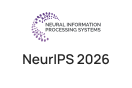
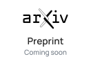
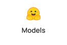
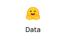

# ProMo3D: Probing Motion Cues in Frozen 3D Foundation Models

<p align="center">
  <a href="https://neurips.cc/virtual/2026/poster/151302"></a>
  <a href="https://xiaoang0211.github.io/ProMo3D/"></a>
  
  <a href="https://huggingface.co/Xiaoang0211/ProMo3D"></a>
  <a href="https://huggingface.co/datasets/Xiaoang0211/ProMo3D-data"></a>
</p>

<!-- Resource links to fill when released:
ARXIV_URL: https://arxiv.org/abs/<paper-id>
-->

Official implementation of **ProMo3D**, presented at **NeurIPS 2026**.

**How much motion information is recoverable from frozen 3D foundation models?** We study this question through low-capacity supervised probing, examining layer-wise motion decodability, the compactness of the probe-induced representation, and transfer with limited source supervision. Building on these findings, **Probing-based Motion Distillation (PMD)** uses a low-rank pairwise probe to convert motion-state compatibility into dynamic score maps and dense motion masks.

<p align="center">
  
</p>

- **Frozen backbones, lightweight readout:** the 3D model stays frozen; only the pairwise probe is trained.
- **Limited source supervision:** probes are trained on 160 YouTube-VOS videos, with rank 8 as the default.
- **Zero-shot benchmark transfer:** DAVIS, SegTrackv2, and FBMS-59 are evaluated without target-benchmark fine-tuning. Coarse PMD and optional SAM2 refinement are reported separately.

## Method

An input frame group provides multi-view or temporal context. PMD reads intermediate spatial tokens and predicts whether token pairs share the same motion state. Compatibility with a fixed static reference token gives the static score; its complement gives the dynamic score. These dynamic scores are reshaped to the token grid and upsampled into a dynamic score map, then binarized to obtain the coarse mask. SAM2 can optionally refine its extent and boundaries.

PMD supports six frozen backbones: **Pi3X, Pi3, VGGT, DA3, MapAnything, and DUSt3R**.

Pretrained rank-8 PMD probes for all six backbones are available on [Hugging Face](https://huggingface.co/Xiaoang0211/ProMo3D). The [training and validation data](https://huggingface.co/datasets/Xiaoang0211/ProMo3D-data) include RGB images and binary motion masks for 160 training and 80 validation sequences. Models are public; dataset downloads require accepting the research-use agreement.

## Setup

Clone the pinned third-party implementations and prepare local interpreter settings:

```bash
bash scripts/setup_third_party.sh Pi3 vggt Depth-Anything-3 map-anything dust3r sam2
cp -n configs/local.env.example configs/local.env
```

Install each backbone using its upstream environment instructions, then install this repository's dependencies in the environments used for PMD:

```bash
pip install -r requirements.txt
```

Set the interpreter paths in `configs/local.env` and place checkpoints at the locations listed in [Setup](docs/setup.md). Separate backbone environments are supported; a single environment containing every model is not required.

For inference-only use with downloaded evaluation datasets, skip the training-data download and follow [Pretrained inference](#pretrained-inference) below. It requires neither YouTube-VOS nor token exports.

To train and evaluate your own probes, download the supplied training/validation subsets and evaluation datasets, then check the installation:

```bash
bash scripts/download_datasets.sh
bash scripts/check_setup.sh --models pi3x pi3 vggt da3 mapanything dust3r
```

Datasets default to `datasets/`. See [Setup](docs/setup.md) for checkpoint paths, reusing existing installations, and runtime overrides for token data stored on another disk.

## Pretrained Inference

Download a backbone's PMD probes, then generate masks, qualitative outputs, and benchmark metrics directly from images, without training or token export:

```bash
bash scripts/download_huggingface.sh --assets models --models pi3x

bash scripts/evaluate.sh pi3x \
  --probe-root outputs/pretrained/pi3x/rank_8/pair_lowrank_quadratic \
  --davis-root /path/to/DAVIS \
  --segtrack-root /path/to/SegTrackv2 \
  --fbms-root /path/to/FBMS-59 \
  --output-dir outputs/predictions/pi3x_native
```

Add `--sam2` for optional refinement and separate coarse/refined evaluation. Dataset paths default to `datasets/`; `--benchmarks` selects individual benchmarks. Outputs include input images, score heatmaps, binary masks, overlays, evaluation JSONs, and a J-Mean/J-Recall CSV. See [Pretrained inference](docs/inference.md) for all six backbones, model bundles, output paths, and submodule use. Backbone environments/checkpoints are still required and obtained from the official sources in [Setup](docs/setup.md).

For probe training, accept the terms on the [data page](https://huggingface.co/datasets/Xiaoang0211/ProMo3D-data), authenticate your local Hugging Face client, and download the source RGB images and masks:

```bash
bash scripts/download_huggingface.sh --assets data
```

Data go to `datasets/youtubevos_160vids/{train,validation}/`; probes go to `outputs/pretrained/<backbone>/rank_8/`. Checksums are verified and different existing files are never overwritten. Existing linked datasets can be reused without downloading; choose a fresh `--data-root` for an independent copy. See the dataset card for the exact source-release provenance and sequence/frame manifests.

## Reproduction

### Image preprocessing

**The paper results use each backbone's native preprocessing.** `native` does not mean "without padding" for every model:

| Backbone | Paper / default preprocessing | Optional padding experiment |
|---|---|---|
| Pi3X, Pi3, VGGT | Native resize-and-pad; padding is already part of the default PMD pipeline | No separate public padding variant |
| DA3, MapAnything, DUSt3R | Native preprocessing, without the additional aspect-padding transform | Optional `aspect_pad`; not used for the paper results |

The native padding implementations are backbone-specific, not one unified transform. The reproduction commands below preserve them. The additional padding option for DA3, MapAnything, and DUSt3R is documented in [Additional experiments](docs/experiments.md) and saves to a separate output tree.

### Training and evaluation

Run the pipeline step by step for all six backbones, or list only the models you want:

```bash
bash scripts/main/run.sh export pi3x pi3 vggt da3 mapanything dust3r
bash scripts/main/run.sh train pi3x pi3 vggt da3 mapanything dust3r
bash scripts/main/run.sh masks pi3x pi3 vggt da3 mapanything dust3r
bash scripts/main/run.sh refine pi3x pi3 vggt da3 mapanything dust3r
bash scripts/main/run.sh eval pi3x pi3 vggt da3 mapanything dust3r
bash scripts/main/run.sh tables
```

**Token export is for probe training and token-level evaluation, not dense mask inference.** The `masks` stage runs the frozen backbone on images and uses the full target-frame token grid. It does not require exported test tokens. `refine` consumes the saved coarse scores, and `eval` reports coarse and SAM2-refined results separately.

The commands support `--dry-run` to inspect paths and settings before running. New main results live under `outputs/main/`; additional experiments live under `outputs/experiments/`; sampled token data live under `outputs/tokens/`.

### Figures and additional experiments

[Main-paper reproduction](docs/main.md) provides the commands for layer-wise figures, rank sweeps, probe-induced PCA, data starvation, and qualitative examples. [Additional experiments](docs/experiments.md) covers matched label controls, binarization robustness, end-to-end runtime, and the six-backbone source-validation diagnostic.

**Layer-wise and starvation plots can be drawn from stored numeric logs without loading exported tokens or masks.** PCA needs sampled tokens and a trained probe; qualitative masks run image inference. The documentation lists the prerequisites for each figure.

## Tests

CPU tests check probe labels and scores, mask construction and evaluation, diagnostic statistics, and reproduction paths without downloading models or datasets:

```bash
pip install -r requirements-dev.txt
bash scripts/test.sh
```

See [Testing](docs/testing.md) for coverage.

## Layout

```text
configs/       Public probe configs, third-party version lock, local settings template
assets/        Images only: logos/ and resource-link images in links/
isdynamic/     Feature adapters, probe training, mask inference, and evaluation
scripts/       Bash entrypoints for setup, main experiments, and additional experiments
tests/         CPU pytest checks without backbones or datasets
docs/          Setup and experiment-to-paper mapping
results/       Small reference tables and provenance; not experiment outputs
datasets/      Downloaded datasets (ignored)
models/        Third-party code and checkpoints (ignored)
outputs/       New experiment outputs (ignored)
bash/          Internal compatibility scripts used by the public entrypoints
```

The project page is maintained separately in the [website repository](https://github.com/Xiaoang0211/Xiaoang0211.github.io/tree/main/ProMo3D). The arXiv record will be added when released.

## Citation

If you find our work helpful, you can cite it as follows:

```bibtex
@inproceedings{zhang2026promo3d,
  title     = {{ProMo3D}: Probing Motion Cues in Frozen {3D} Foundation Models},
  author    = {Zhang, Xiaoang and Kiray, Mert and Velikova, Yordanka and Biswanath, Manoj and Busam, Benjamin},
  booktitle = {Advances in Neural Information Processing Systems},
  year      = {2026},
  url       = {https://neurips.cc/virtual/2026/poster/151302}
}
```

## Acknowledgements

Our pairwise representation-probing formulation is inspired by Li et al.'s [Does Object Binding Naturally Emerge in Large Pretrained Vision Transformers?](https://github.com/liyihao0302/vit-object-binding), including its IsSameObject probing perspective and linear/quadratic probe formulations. PMD applies this perspective to motion-state compatibility in frozen 3D representations.

We thank the authors of [Pi3/Pi3X](https://github.com/yyfz/Pi3), [VGGT](https://github.com/facebookresearch/vggt), [Depth Anything 3](https://github.com/ByteDance-Seed/Depth-Anything-3), [MapAnything](https://github.com/facebookresearch/map-anything), [DUSt3R](https://github.com/naver/dust3r), and [SAM2](https://github.com/facebookresearch/sam2) for their public implementations. Additional experiment and comparison utilities also use [VGGT-omega](https://github.com/facebookresearch/vggt-omega), [GeoMotion](https://github.com/zjutcvg/GeoMotion), [Flow-SAM](https://github.com/Jyxarthur/flowsam), and [SegAnyMo](https://github.com/nnanhuang/SegAnyMo).

## License

Original ProMo3D code is released under the [MIT License](LICENSE). Third-party code, pretrained models, datasets, and media retain their respective licenses and terms. This license does not relicense assets downloaded from Hugging Face or upstream providers.
