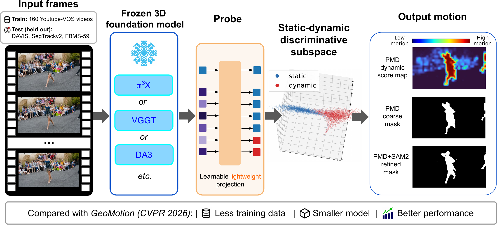

# ProMo3D: Probing Motion Cues in Frozen 3D Foundation Models

<p align="center">
  <a href="https://neurips.cc/virtual/2026/poster/151302"><strong>NeurIPS 2026</strong></a>
  &nbsp;|&nbsp; <a href="https://xiaoang0211.github.io/ProMo3D/">Project Page</a>
  &nbsp;|&nbsp; arXiv (coming soon)
  &nbsp;|&nbsp; Hugging Face Model Card (coming soon)
</p>

<!-- Resource links to fill when released:
ARXIV_URL: https://arxiv.org/abs/<paper-id>
HUGGINGFACE_MODEL_CARD_URL: https://huggingface.co/<owner>/<model>
-->

**How much motion information is already recoverable from frozen 3D foundation models?** ProMo3D investigates this question through lightweight representation probing. Our method, **Probing-based Motion Distillation (PMD)**, learns a low-rank pairwise readout of frozen tokens and converts motion-state compatibility into dense motion masks.

<p align="center">
  
</p>

- **Frozen backbones, lightweight readout:** the 3D model stays frozen; only the pairwise probe is trained.
- **Limited source supervision:** probes are trained on 160 YouTube-VOS videos, with rank 8 as the default.
- **Zero-shot benchmark transfer:** DAVIS, SegTrackv2, and FBMS-59 are evaluated without target-benchmark fine-tuning. Coarse PMD and optional SAM2 refinement are reported separately.

## Method

An input frame group provides multi-view or temporal context. PMD reads intermediate spatial tokens, predicts whether token pairs share the same motion state, and converts compatibility with a fixed reference token into a dynamic score map. The scores are reshaped to the token grid, upsampled, and binarized to obtain the coarse mask. SAM2 can optionally refine its extent and boundaries.

The release includes Pi3X, Pi3, VGGT, DA3, MapAnything, and DUSt3R. [Main-paper reproduction](docs/main.md) covers the selected token groups, layer-wise probing, low-rank analysis, probe-induced PCA, and data-starvation experiments.

## Setup

Clone the pinned third-party implementations and prepare local interpreter settings:

```bash
bash scripts/setup_third_party.sh Pi3 vggt Depth-Anything-3 map-anything dust3r sam2
cp -n configs/local.env.example configs/local.env
```

Install each backbone using its upstream environment instructions, then install this repository's dependencies in the environments used for PMD:

```bash
pip install -r requirements.txt
```

Set the interpreter paths in `configs/local.env` and place checkpoints at the locations listed in [Setup](docs/setup.md). Separate backbone environments are supported; a single environment containing every model is not required.

Download the supplied motion-mask training/validation subsets and evaluation datasets, then check the installation:

```bash
bash scripts/download_datasets.sh
bash scripts/check_setup.sh --models pi3x pi3 vggt da3 mapanything dust3r
```

Datasets default to `datasets/`. See [Setup](docs/setup.md) for checkpoint paths, reusing existing installations, and runtime overrides for token data stored on another disk.

## Reproduction

### Image preprocessing

**The paper results use each backbone's native preprocessing.** `native` does not mean "without padding" for every model:

| Backbone | Paper / default preprocessing | Optional padding experiment |
|---|---|---|
| Pi3X, Pi3, VGGT | Native resize-and-pad; padding is already part of the default PMD pipeline | No separate public padding variant |
| DA3, MapAnything, DUSt3R | Native preprocessing, without the additional aspect-padding transform | Optional `aspect_pad`; not used for the paper results |

The native padding implementations are backbone-specific, not one unified transform. The reproduction commands below preserve them. The additional padding option for DA3, MapAnything, and DUSt3R is documented in [Additional experiments](docs/experiments.md) and saves to a separate output tree.

### Training and evaluation

Run the pipeline step by step for all six backbones, or list only the models you want:

```bash
bash scripts/main/run.sh export pi3x pi3 vggt da3 mapanything dust3r
bash scripts/main/run.sh train pi3x pi3 vggt da3 mapanything dust3r
bash scripts/main/run.sh masks pi3x pi3 vggt da3 mapanything dust3r
bash scripts/main/run.sh refine pi3x pi3 vggt da3 mapanything dust3r
bash scripts/main/run.sh eval pi3x pi3 vggt da3 mapanything dust3r
bash scripts/main/run.sh tables
```

**Token export is for probe training and token-level evaluation, not dense mask inference.** The `masks` stage runs the frozen backbone on images and uses the full target-frame token grid. It does not require exported test tokens. `refine` consumes the saved coarse scores, and `eval` reports coarse and SAM2-refined results separately.

The commands support `--dry-run` to inspect paths and settings before running. New main results live under `outputs/main/`; additional experiments live under `outputs/experiments/`; sampled token data live under `outputs/tokens/`. The original research workspace and its outputs are not overwritten.

### Figures and additional experiments

[Main-paper reproduction](docs/main.md) provides the commands for layer-wise figures, rank sweeps, probe-induced PCA, data starvation, and qualitative examples. [Additional experiments](docs/experiments.md) covers matched label controls, binarization robustness, end-to-end runtime, and the six-backbone source-validation diagnostic.

**Layer-wise and starvation plots can be drawn from stored numeric logs without loading exported tokens or masks.** PCA needs sampled tokens and a trained probe; qualitative masks run image inference. The documentation lists the prerequisites for each figure.

## Tests

CPU tests check probe labels and scores, mask construction and evaluation, diagnostic statistics, and reproduction paths without downloading models or datasets:

```bash
pip install -r requirements-dev.txt
bash scripts/test.sh
```

See [Testing](docs/testing.md) for coverage.

## Layout

```text
configs/       Public probe configs, third-party version lock, local settings template
isdynamic/     Feature adapters, probe training, mask inference, and evaluation
scripts/       Bash entrypoints for setup, main experiments, and additional experiments
tests/         CPU pytest checks without backbones or datasets
docs/          Setup and experiment-to-paper mapping
results/       Small reference tables and provenance; not experiment outputs
project_page/  Project-page asset staging
datasets/      Downloaded datasets (ignored)
models/        Third-party code and checkpoints (ignored)
outputs/       New experiment outputs (ignored)
bash/          Internal compatibility scripts used by the public entrypoints
```

Third-party implementations and checkpoints retain their original licenses. The arXiv record, Hugging Face Model Card, and final citation will be added when released.
